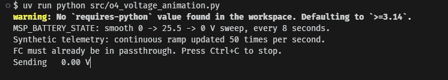
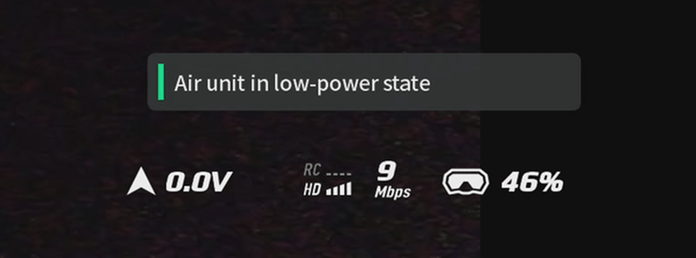

# I thought I had killed my O4 Lite

I'd finished building my drone, and everything was working: video, OSD, battery
voltage and automatic recording.

While making a few changes, I was removing the O4 from its mount. It caught at
an angle. When I pulled it free, a corner of the PCB snapped off near a mounting
hole.

My first thought was that I'd just destroyed a $250 air unit.

I plugged it back in and powered it up. Video and OSD still worked, so I thought
I'd got away with it. Then I noticed DJI's own battery display was stuck at
**0 V**, and automatic recording on arm/disarm had stopped working.

## The clue was that the OSD still worked

Betaflight's OSD showed the correct voltage. DJI's separate overlay did not.

I checked the wiring with a multimeter. There were no obvious shorts, and the
pads still had continuity. Using the FC's USB-to-UART passthrough and Python,
I could send information to the O4, but I wasn't receiving anything back.

My suspicion was that the damage had affected the O4's UART transmit path.
The O4 could still receive the OSD, but perhaps its requests for battery and
arming information were no longer reaching the flight controller.

## Could I send the information anyway?

I tried sending battery replies without waiting for the O4 to ask for them.
To make the result obvious, I made the reported voltage sweep up and down.
The power supply stayed unchanged; these were deliberately fake telemetry values.

**This is the Python side of the experiment:**

**And this is what the goggles showed:**

The native voltage display followed the sweep. That was the result I needed:
the O4 would accept the information even without requesting it first.

These clips show the voltage test only. The low-power warning is still visible
in the goggles recording. I tested armed/disarmed status separately, and that
worked too.

## Making it work without the computer

The Python test proved the idea, but I needed the flight controller to do it
on its own.

I modified Betaflight to periodically send the same two replies, using the
**real battery voltage and armed state** from its existing telemetry code.
After building and flashing it onto my NewBeeDrone Hummingbird AIO255, I tested
it with the O4.

**The original problems were resolved.** The workaround now runs on the flight
controller, with no Python script or extra hardware needed during use.

I still haven't confirmed exactly which trace or component was damaged, so a
broken UART transmit path remains my diagnosis rather than a proven electrical
finding. More flight testing is the next step to check reliability in normal use.

If you're seeing the same symptoms, I've shared a [simple user guide](O4_QUICK_START.md)
and the [exact implementation changes](https://github.com/Shayman-M-86/betaflight/commit/0d11aff655704b10cabeb7457b37c0de28bf4fc8).
You can also follow the [original discussion](https://github.com/betaflight/betaflight/discussions/15847).
